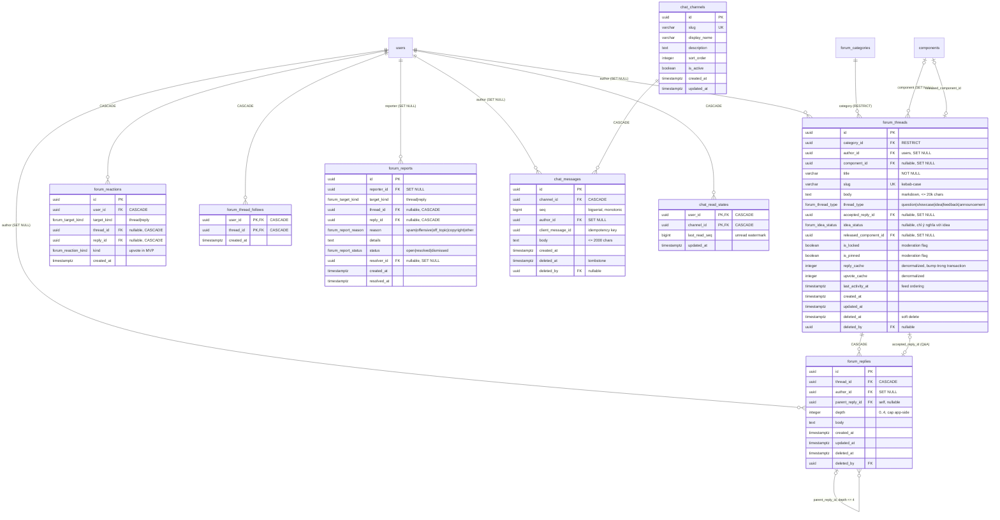

# Community & Live Chat — Kiến trúc sản phẩm & hệ thống

> Trạng thái: **DESIGN** — đây là tài liệu kiến trúc, không chứa thay đổi code.
> Các quyết định cốt lõi chờ 2 owner xác nhận nằm ở §13.
> Đối chiếu: root `AGENTS.md`, `docs/ENGINEERING.md`, issues #17 #18 #28–#33 (tổng hợp ở §0). Skill consulted: `api-design`, `backend-patterns`, `api-conventions`, `changing-the-database-schema`.

## 0. Audit (Phase 1) — EXISTING / PLANNED / PROPOSED

| Thành phần | Trạng thái | Bằng chứng |
|---|---|---|
| `users` (đã có các field Better Auth user model: `email_verified`, `image`, `role` pgEnum `user\|seller\|admin`) | EXISTING | `packages/db/src/schema.ts`, migration 0000 |
| `components` | EXISTING | như trên |
| API contracts catalog + pagination + error envelope | EXISTING | `packages/shared/src/contracts/{catalog,common}.ts` (PR #39, đã merge) |
| Web foundation (Next 16, Tailwind 4 tokens, `lib/api-client`, `API_MODE=mock|live`) | EXISTING | PR #38, đã merge |
| Better Auth integration | PLANNED — chưa có code | issue #17 đang mở; grep không thấy dependency — không gán quyền cho identity chưa tồn tại |
| API bootstrap (typed env, error middleware, logging, CORS) | PLANNED | issue #29 đang mở; `apps/api/src/index.ts` hiện chỉ có `/health`, `/health/db` |
| Catalog read endpoints + web data layer | PLANNED | issues #31, #32 |
| Forum + Chat (bảng, routes, WS, UI) | PROPOSED | chính tài liệu này |

Hệ quả thiết kế: mọi authorization được thiết kế quanh "Better Auth session có sẵn", nhưng trong roadmap M1, auth integration (#17) là bước số 0 — có tables/schemas có thể build song song, còn endpoints write thì không chạy được khi chưa có identity thật. Mọi bảng mới FK vào `users.id` hiện hữu — không tạo users thứ hai.

## 1. Product vision

Ba domain — Marketplace, Community Forum, Live Chat — phục vụ một chuỗi giá trị chung:

```
Component → Discussion → Feedback → Improvement → New Component
```

- **Marketplace**: nơi component được khám phá, preview, chia sẻ và mua (catalog skeleton đã có).
- **Forum**: nơi component được bàn sâu — hỏi đáp, showcase, góp ý, phát sinh ý tưởng mới.
- **Chat**: nơi trao đổi realtime nhanh; trao đổi dài và có kết luận quay về forum.

Nguyên tắc bản sắc: **không clone Discord/Reddit**. Forum có cấu trúc chặt (categories, thread type, accepted answer, idea lifecycle gắn component); Chat là phòng trao đổi trực tuyến phục vụ forum chứ không thay thế forum. Cả hai chia sẻ identity, permission model và khả năng link nội dung chéo (thread ↔ component, message → thread).

Ghi chú tham khảo: ý tưởng marketplace lấy cảm hứng từ các thư viện UI component dạng catalog (ví dụ Aceternity UI, https://ui.aceternity.com/components); ý tưởng có lớp chat realtime lấy cảm hứng khái niệm từ Discord — nhưng không dựa vào cấu trúc/UX của Discord, đúng theo nguyên tắc bản sắc ở trên.

## 2. Forum vs Chat — phân dòng trách nhiệm

| Khía cạnh | Forum | Chat |
|---|---|---|
| Nội dung | Markdown dài, có cấu trúc, search được | Tin nhắn ngắn ≤ 2000 ký tự, realtime |
| Vòng đời | Tombstone soft-delete + audit path | Tombstone + event `message.deleted` |
| Bảng chính | `forum_threads`, `forum_replies`, `forum_categories` | `chat_channels`, `chat_messages` |
| Liên kết chéo | `component_id` trên thread (Discussions tab) | message chứa link → thread (M4) |
| Đọc | SSR/RSC là đủ cho MVP | Realtime WS + history paginate |
| Sort/search | `q` + `sort` + phân trang | Lịch sử theo `seq`, không search MVP |

**Biên rành mạch giữa hai domain:** Chat không cập nhật forum state — một tin nhắn "làm cái này đi" không bao giờ tự đổi `idea_status`; chỉ thread author hoặc moderator được đổi lifecycle qua REST. Forum không broadcast realtime; chỉ Chat module có WS transport.

## 3. User journeys

### 3.1 Component → Discussion → Feedback
```
Dev mở /components/[slug]
  → tab "Discussions" → tạo thread Q&A hoặc Feedback (gắn component)
  → creator (component.authorId) trả lời
  → resolve: mark accepted answer (Q&A) hoặc mod close
  → component ra phiên bản mới → thread bump activity → badge version
```

### 3.2 Community idea → vote → component mới
```
Dev đăng idea trong "Ideas & Component Requests"
  → cộng đồng upvote
  → thread author/mod chuyển idea_status: planned → in_progress → released
  → released_component_id trỏ tới component mới
  → thread hiện badge "shipped as X" (follows nhận thông báo ở M4)
```

### 3.3 Chat = agora nhanh
```
Dev vào #frontend-help → hỏi nhanh, được trả lời ngay
  → câu hỏi trở nên dài dòng → paste link /community/threads/[id]
  → long-form + kết luận (accepted answer) nằm ở forum, tồn tại lâu dài
```

## 4. Information architecture

Routes (đề xuất, có ghi chú lệch so với task ở D4):

```
app/
├── /components                        (Marketplace listing)
├── /components/[slug]                  (detail + Discussions section)
├── /community                          (feed 5 categories, filter + sort)
│   ├── /community/new                  (create thread)
│   └── /community/threads/[threadId]   (detail + replies + accepted answer)
└── /chat                               (channel rail + active room)
```

Task gốc gợi ý `/community/[threadId]`; tôi đề xuất `/community/threads/[threadId]` để không đụng `/community/new` và để sau này mở rộng `/community/[category]` không bị conflict (D4).

Categories ban đầu (5, seed theo D8):

| slug | Thread type mặc định | Ai post |
|---|---|---|
| `help` | `question` | mọi authenticated |
| `showcase` | `showcase` | mọi authenticated |
| `ideas` | `idea` | mọi authenticated |
| `feedback` | `feedback` | mọi authenticated |
| `announcements` | `announcement` | moderator/admin only |

## 5. Logical module architecture (modular monolith)

```
Bun + Express — 1 process, 1 PostgreSQL, 1 identity (Better Auth)
├── apps/api
│   ├── app.ts                     (mount routers + ws upgrade handler)
│   ├── routes/community.ts        (forum REST)
│   ├── routes/chat.ts             (chat REST)
│   ├── ws/chat.ts                 (WS upgrade + in-process fan-out)
│   └── middleware/{auth,rate-limit,zod-validate}.ts
├── packages/db                    (forum_* + chat_* tables, migrations forward-only)
└── packages/shared                (contracts/community.ts, chat.ts, realtime.ts)
```

Lý do modular monolith thay vì microservices: team 2 người; chung một PostgreSQL cho phép FK thật và transaction thật (reply + counter bump); tránh operational burden của service mesh/broker. Không thêm Redis/Kafka cho MVP — in-process WS fan-out là đủ. Guard-rail cho tương lai đa-instance: chỉ cần thay broadcast layer bằng adapter pub/sub, business code không đổi.

## 6. Database architecture (ERD)



### 6.1 Thiết kế từng bảng

**PK & FK.** UUID PK khớp chuẩn repo. FK `author_id`/`deleted_by` → `SET NULL`: xóa user không nuốt nội dung cộng đồng. Ngoại lệ CASCADE áp cho per-user data (`forum_reactions`, `forum_thread_follows`, `chat_read_states`) — dữ liệu vô nghĩa khi user biến mất. `forum_threads.category_id` = RESTRICT (không xóa category còn thread). `forum_replies.thread_id`, `chat_messages.channel_id` = CASCADE. `component_id`/`released_component_id` = SET NULL — component xóa cũng giữ thread vì content cộng đồng sống độc lập.

**Nullability.** `title`, `body`, `slug` NOT NULL (slug do app sinh, unique). `chat_messages.author_id` nullable để tombstone sống khi author xóa tài khoản. `accepted_reply_id`, `idea_status`, `released_component_id`, `parent_reply_id`, `deleted_*`, `details` nullable.

**Unique constraints.** `forum_threads.slug`; `chat_channels.slug`; `chat_messages(channel_id, client_message_id)` — idempotency; `forum_thread_follows(user_id, thread_id)`; `chat_read_states(user_id, channel_id)`; reactions dùng 2 partial unique index: `(user_id, thread_id) WHERE reply_id IS NULL` và `(user_id, reply_id) WHERE thread_id IS NULL`.

**Status & visibility — tránh enum chung vô nghĩa.** `accepted_reply_id` chỉ có ý nghĩa khi `thread_type = 'question'`; `idea_status` (`planned|in_progress|released|rejected`, null = submitted) chỉ khi `thread_type = 'idea'` — cả hai enforce ở middleware/validation (PG CHECK với cross-row lookup không sạch, không dùng). `is_locked`/`is_pinned` là moderation flags áp cho mọi thread type. `deleted_at` + `deleted_by` = tombstone cho cả forum và chat.

`chat_memberships` — **không tạo trong MVP**: mọi channel public; quyền write được tính từ auth state + `is_active`. Bảng này chỉ cần khi DM/private channels xuất hiện (M4 guard-rail).

Seed data: 5 categories + 4 chat channels (`general`, `frontend-help`, `showcase`, `feedback`) được đưa vào migration data để mọi môi trường (local, CI, prod) có cùng trạng thái khởi đầu (D8).

### 6.2 Indexes — ánh xạ theo query thực tế

| Query thực tế | Index |
|---|---|
| Feed: threads theo category, sort theo activity | `(category_id, last_activity_at DESC)` partial `WHERE deleted_at IS NULL` |
| Replies của thread (detail page) | `(thread_id, created_at)` |
| Discussions gắn component | `(component_id)` partial `WHERE deleted_at IS NULL` |
| Unread badge: `EXISTS (chat_messages WHERE seq > last_read_seq)` | `(channel_id, seq)` — read_state lookup theo PK `(user_id, channel_id)` |
| History paginate `beforeSeq` | `(channel_id, seq)` |
| Chống dup vote | 2 partial unique indexes ở trên |
| Report queue (mod) | `(status, created_at)` partial `WHERE status = 'open'` |
| Fulltext search (M4) | GIN `to_tsvector` trên title/body — chờ metrics; MVP dùng `ILIKE` |

### 6.3 Transaction boundaries & concurrency

- **Reply + counter bump** trong một transaction: `INSERT reply` → `UPDATE forum_threads SET reply_cache = reply_cache + 1, last_activity_at = now()` → COMMIT. Không dùng trigger (khó debug); nếu counter drift, job đếm lại là đủ cho MVP.
- **Reaction concurrency**: `INSERT ... ON CONFLICT DO NOTHING` dựa trên partial unique index; unvote = `DELETE`. Không cần advisory lock; test đồng thời phải chứng minh 10 upvote song song → đúng 1 row.
- **Chat idempotency**: `INSERT ... ON CONFLICT (channel_id, client_message_id) DO NOTHING` + `RETURNING`; nếu RETURNING rỗng → SELECT row hiện có và trả lại (HTTP 200 trên retry). Giúp retry sau mất-ACK không tạo duplicate.
- **Ordering + reconnect**: `seq bigserial` là con trỏ tuyệt đối; client gửi `resume.afterSeq` và server replay các message persist đã miss theo `seq` — clock sync hay clock skew của client không ảnh hưởng thứ tự.
- **Read state upsert**: `INSERT ... ON CONFLICT (user_id, channel_id) DO UPDATE SET last_read_seq = GREATEST(chat_read_states.last_read_seq, EXCLUDED.last_read_seq)` — chặn việc client lag kéo watermark lùi.
- **Soft delete + audit**: forum tombstone (`deleted_at`, `deleted_by`) để moderator audit/undo được; chat tombstone giữ row để `seq` trơn tru khi replay event. `resolver_id` + `resolved_at` trong reports đóng vòng audit MVP — không cần bảng audit-log riêng cho quy mô team này (trade-off ở §13).

## 7. API contract architecture (`packages/shared/contracts/`)

Quy tắc: Long đề xuất, Văn review (sao cho wrap đúng pattern đã dùng cho catalog). Framework-free, Zod 4, phân biệt rõ request/response/event; tái sử dụng `PAGINATION_LIMITS`, `pageNumberSchema`, `pageSizeNumberSchema`, `apiErrorSchema` từ `contracts/common.ts` — không viết lại primitives.

```
packages/shared/src/contracts/
├── community.ts     (threads, replies, categories, reports — REST)
├── chat.ts          (channels, messages — REST)
└── realtime.ts      (WS event envelopes cho chat)
```

### 7.1 Community REST

| Method & path | Request schema | Response schema | Auth |
|---|---|---|---|
| `GET /community/threads` | `threadListQuerySchema` — `category?`, `threadType?`, `componentSlug?`, `author?`, `sort` (`active\|newest\|top`, default `active`), `q?`, `page`, `pageSize` | `threadListResponseSchema` `{ items: threadSummarySchema[], page, pageSize, total }` | public |
| `GET /community/threads/:id` | `threadIdParamSchema` (uuid) | `threadResponseSchema` `{ thread: threadSchema, replies: replySchema[] }` — accepted reply luôn nằm trong danh sách | public |
| `GET /community/threads/:id/replies` | `{ page, pageSize, sort: oldest\|newest }` | `replyListResponseSchema` | public |
| `POST /community/threads` | `createThreadSchema` `{ title, body, categorySlug, threadType, componentSlug?, tags? }` — validate threadType khớp category (help→question, ideas→idea, …) | `201 { thread }` | auth + rate limit |
| `PATCH /community/threads/:id` | `updateThreadSchema` — author: `title/body/tags`; thread author Q&A: `acceptedReplyId`; moderator: `isLocked/isPinned/ideaStatus` | `200 { thread }` | owner hoặc moderator |
| `DELETE /community/threads/:id` | — | `204` | owner (self soft-delete) hoặc moderator |
| `POST /community/threads/:id/replies` | `createReplySchema` `{ body, parentReplyId?, clientMessageId }` | `201 { reply }` | auth + rate limit |
| `POST /community/threads/:id/reactions` | `createReactionSchema` `{ targetKind: 'thread', targetId, kind: 'upvote' }` — idempotent | `201 { reaction }` | auth |
| `DELETE /community/threads/:id/reactions` | same | `204` | auth |
| `GET /community/threads/:id/replies/:replyId/reactions` (M2) | — | `{ count, viewerReacted }` | public |
| `POST /community/reports` | `createReportSchema` `{ targetKind, targetId, reason, details? }` | `201 { report }` | auth |
| `GET /community/reports` (M2, mod only) | `{ status? }` | `reportListResponseSchema` | moderator/admin |
| `GET /components/:slug/discussions` | slug + `threadListQuerySchema` | `threadListResponseSchema` | public |

Error chuẩn hóa: mọi failure trả `apiErrorSchema` (`400 VALIDATION_ERROR`, `401 UNAUTHENTICATED`, `403 FORBIDDEN`, `404 NOT_FOUND`, `429 RATE_LIMITED`) — đúng một envelope, đã ship trong #39, middleware error #29 dùng lại — không tạo envelope thứ hai.

### 7.2 Chat REST

| Method & path | Request | Response | Auth |
|---|---|---|---|
| `GET /chat/channels` | — | `chatChannelListSchema` — sorted by `sort_order`; kèm `unread` viewer-state khi có session | public read (D2) |
| `GET /chat/channels/:id/messages` | `{ beforeSeq?, afterSeq?, limit ≤ 100, default 50 }` | `chatMessageListSchema` `{ messages[] (ASC theo seq), hasMore }` | public read (D2) |
| `POST /chat/channels/:id/messages` | `createChatMessageSchema` `{ body ≤ 2000, clientMessageId }` | `201 chatMessageSchema`; retry trùng `clientMessageId` → `200` cùng payload | auth + rate limit |

### 7.3 Realtime events (`contracts/realtime.ts`)

Server → client (pseudo-code; sẽ thành zod thật khi implement contract):
```ts
export const chatEventSchema = z.discriminatedUnion('type', [
  z.object({ type: z.literal('message.created'), data: chatMessageSchema }), // broadcast + replay dùng chung một shape
  z.object({ type: z.literal('message.deleted'), data: chatDeletedRefSchema }), // { channelId, id, seq, deletedAt }
  z.object({ type: z.literal('ack'),            data: chatAckSchema }), // { refClientMessageId, message }
  z.object({ type: z.literal('error'),          data: apiErrorSchema }), // WS error tái dùng REST envelope
])
```

Client → server:
```ts
export const chatCommandSchema = z.discriminatedUnion('type', [
  z.object({ type: z.literal('send'),         data: { channelId, body, clientMessageId } }),
  z.object({ type: z.literal('resume'),       data: { afterSeq: z.int().min(0) } }), // replay sau reconnect
  z.object({ type: z.literal('read.advance'), data: { channelId, lastReadSeq } }),   // update watermark
])
```

- **Event naming**: `message.created`, `message.deleted`, `ack`, `error` — không dùng generic `update`/`change`.
- **Ordering**: `seq bigserial` là con trỏ chuẩn; client chỉ cần `afterSeq`, không cần clock sync.
- **Dedupe**: client đi theo `message.id`; POST retry reuse `clientMessageId`; WS replay dedup theo id.
- **Reconnect**: server heartbeat ping/pong 30s; client backoff 1→2→…→30s (jitter) rồi `resume.afterSeq`. Persistence Postgres là nguồn chân lý — realtime chỉ là delivery.
- **Out-of-scope MVP**: typing/presence/mentions/attachments/DM — phần mở rộng event schema sau này vẫn backward-compatible vì envelope đã `discriminatedUnion`.

### 7.4 Realtime transport — options và lựa chọn

| Option | Chọn | Lý do |
|---|---|---|
| **In-process `ws` WebSocket trên Bun HTTP server** | ✅ MVP | Zero infra; Bun chạy được cùng Express; fan-out là iteration trong memory; đủ cho single instance |
| SSE + POST | ✗ | một chiều, ack/reconnect phức tạp hơn WS |
| GraphQL Subscription / tRPC | ✗ | thêm stack mới cho nhu cầu một app nhỏ |
| Redis pub/sub fan-out | ✗ MVP, mở khi M4 multi-instance | chỉ thay ws broadcast layer, business code giữ nguyên |
| REST long-polling | ✗ | UX kém, tốn connection |

Single-file WS design (`ws/chat.ts`):
1. `server.on('upgrade')` scoped `/ws/chat`.
2. Upgrade handshake kiểm tra Better Auth session cookie — fail → từ chối upgrade (guest D2 vẫn được read-only subscribe).
3. Mỗi connection giữ `subscriptions: Set<channelId>` + rate-limit riêng.
4. Broadcast: iterate connection set (same process) cho `message.created`/`message.deleted` theo các channel đã subscribe.
5. Resume: replay các message đã miss từ PostgreSQL theo `afterSeq`, xong chuyển sang live stream — `seq` là gate đảm bảo replay + live không dup và đúng thứ tự.

## 8. Security & permissions

### 8.1 Permission matrix

| Hành động | Guest | Authenticated | Content author | Moderator | Admin |
|---|---|---|---|---|---|
| Đọc forum threads/replies/categories | ✅ | ✅ | ✅ | ✅ | ✅ |
| Tạo thread/reply | ✗ | ✅ (rate-limited) | ✅ | ✅ | ✅ |
| React/unvote | ✗ | ✅ | ✅ | ✅ | ✅ |
| Edit/delete content của mình | ✗ | ✗ | ✅ own | ✅ any | ✅ |
| Chọn `accepted_reply_id` (Q&A) | ✗ | ✗ | thread author | ✅ | ✅ |
| Đổi `idea_status` | ✗ | ✗ | thread author | ✅ | ✅ |
| Lock / pin / post announcement | ✗ | ✗ | ✗ | ✅ | ✅ |
| Gửi report | ✗ | ✅ | ✅ | ✅ | ✅ |
| Xử lý report queue | ✗ | ✗ | ✗ | ✅ | ✅ |
| Đọc chat messages | ✅ (D2) | ✅ | ✅ | ✅ | ✅ |
| Gửi chat message | ✗ | ✅ (rate-limited) | ✅ | ✅ | ✅ |
| Delete chat message | ✗ | ✗ | own | ✅ any | ✅ any |

**Seller không mặc định có quyền moderator.** Seller là business role cho marketplace listing; quyền cộng đồng (moderator) là phép cộng thêm — quyết định tại D1 (thêm `'moderator'` vào `user_role` pgEnum hay chỉ dùng admin).

### 8.2 Biện pháp tối thiểu (M1–M3)

- **Server-side authorization** tại mọi route + WS command — không tin client claims.
- **Zod validation**: mọi request parse qua contract; ngoài contract → `400 VALIDATION_ERROR`.
- **Rate limits** (in-process token bucket; upgrade Redis adapter khi multi-instance): thread 5/user/10min; reply 15/user/10min; chat 20/user/10s; WS connect 5/IP/5min.
- **Anti-spam heuristics M1**: title ≥ 8 chars, body ≥ 20 chars, tối đa 2 links/post; chỉ user `email_verified = true` mới write (field đã có trong schema `users` — Better Auth).
- **Safe Markdown**: raw HTML bên trong markdown bị strip; link chỉ `http(s)`/relative; `<script>`/`javascript:` chặn; image allowlist domain. Stack cụ thể (`unified/rehype-sanitize` vs `marked` + `DOMPurify`) là D3, Văn PoC rồi chốt.
- **XSS prevention**: mọi user content render qua sanitizer; inline style bị strip; CSP `script-src 'self'` chặn script injection từ user content.
- **Không thực thi TSX/JS do user post**: marketplace preview chỉ qua sandboxed iframe (future scope), không bao giờ chạy trong document chính.
- **WS authentication**: session cookie Better Auth được xác nhận ở bước upgrade; guest (theo D2) chỉ được subscribe read-only, mọi command `send` bị server từ chối.
- **Channel membership validation**: MVP dựa trên `is_active` + role (không cần membership table); M4 nếu có DM/private channels mới thêm `chat_memberships` và per-connection membership check.
- **Report/flagging**: mọi content có thể report; resolve/dismiss chỉ moderator; report không tự xóa content.

### 8.3 Identity

Better Auth là nguồn identity duy nhất cho Marketplace + Forum + Chat. `users` table đã được định nghĩa sẵn các field cần cho Better Auth (`email_verified`, `image`) và một app-owned `role` — integration ghép qua `drizzleAdapter` (issue #17). Không tạo session system thứ hai, không tạo users table thứ hai, không sinh JWT riêng.

## 9. Frontend UX architecture (`apps/web` — Văn)

### 9.1 Feature modules

```
apps/web/
├── app/community/page.tsx                          (feed + filter + sort)
├── app/community/new/page.tsx                      (create thread)
├── app/community/threads/[threadId]/page.tsx       (detail + replies + accepted highlight)
├── app/chat/page.tsx                               (channel rail + room)
├── app/components/[slug]/page.tsx                  (thêm Discussions section)
├── components/community/{thread-card,thread-list,thread-form,reply-tree,markdown-body}.tsx
├── components/chat/{channel-list,message-list,message-composer,connection-status}.tsx
├── features/community/{community-source.ts, +test}  (mock|live như catalog)
└── features/chat/{chat-source.ts,+test, use-chat-socket.ts}
```

- **Reuse foundation pattern #38**: RSC mặc định; `features/<x>/<x>-source.ts` là điểm data duy nhất; `API_MODE=mock|live` — mock fixtures viết đồng bộ với zod contracts, thay bằng HTTP adapter không phải đụng UI.
- **Server islands vs client islands**: feed/detail/list là RSC; client islands chỉ những thứ cần state/interactivity: `thread-form`, `reply-tree` composer, `reaction` buttons, `report` modal; `chat` là một client island duy nhất (socket chỉ tồn tại trong browser).

### 9.2 Screens & states

| Screen | States cần có |
|---|---|
| Community feed | loading / empty / error+retry / filter-active / guest-read notice |
| Thread detail | loading / not-found / locked banner / accepted answer highlight / reply tree depth cap / pagination |
| Create thread | form validation (threadType khớp category) / unauth CTA / rate-limit message |
| Component Discussions | empty state / sorted-by-activity list |
| Channel list | active channels / unread badge / ws-down disabled |
| Chat room | connecting / connected / reconnecting badge / tombstone messages / history infinite scroll / empty state |
| Error states | 400/401/403/404/429 render message friendly, đủ info để retry đúng |

**Responsive**: chat desktop = rail 220px + room flex; tablet = channel chip bar; mobile = full-screen swap (channel list ↔ room + Back). Forum detail `max-w-2xl` prose. Reply tree depth visual max 2 level trên mobile (data vẫn đến 4).

**Accessibility**: `aria-live=polite` cho message stream; composer có label; reaction button `aria-pressed`; focus ring theo design tokens; reply nesting dùng `role="list"`.

## 10. MVP scope vs future scope

**MVP (M1–M3)**: 5 categories seeded; threads/replies nested ≤ 4; upvote (1 kind); accepted answer cho Q&A; idea lifecycle (author/mod đổi); announcements mod-only; search = `q` ILIKE; chat: 4 channels seeded, realtime in-process WS, persistence Postgres, reconnect `resume`, unread state, delete own/any (mod), report queue + lock/pin; rate limits; responsive chat mobile.

**Không build trong MVP** (mở lại khi metrics đòi):
1. Payments/licenses/seller marketplace flows (issue #18 research).
2. Component execution sandbox cho preview user code.
3. DM + attachments + mentions + typing/presence.
4. Notifications (in-app/email/push) ngoài badge unread chat.
5. Fulltext search GIN/tsvector.
6. Multi-instance WS adapter/broker.
7. Reputation/badges/leaderboard.
8. Bots/automation/webhooks.
9. Voice/video — hoàn toàn out-of-scope.

## 11. Team ownership

| Domain | Long | Văn |
|---|---|---|
| Contracts | Đề xuất zod schemas (`community.ts`, `chat.ts`, `realtime.ts`) | Review + mock fixtures khớp |
| Database | `forum_*`, `chat_*` tables + migrations forward-only | — (chỉ consumer) |
| API + realtime transport | REST routes + `ws/chat.ts` + middleware | client socket hook |
| Security | server-side auth, rate limit, anti-spam, WS handshake | render sanitizer, safe markdown, CSP |
| UI | — | Community + Chat UI (responsive, a11y) |

Cross-domain bugs: report issue → owner domain đó fix; không tự sửa code domain khác (theo `docs/ENGINEERING.md`).

## 12. Milestones

### M1 — Forum Core

- **Dependencies**: #17 (Better Auth) là dependency quan trọng nhất; #29 (bootstrap) có thể cùng batch. Tables có thể build song song trước auth; endpoints write chờ auth.
- **Backend (Long)**: auth integration; migration `forum_categories` (seed) + `forum_threads` + `forum_replies`; REST endpoints (list/detail/create/reply/patch/accepted answer khi Q&A); permission middleware con của admin/mod; rate-limit core; error envelope middleware.
- **Frontend (Văn)**: routes + mock fixtures khớp contract; feed/detail/create-form; component Discussions section; safe-markdown render; unauth CTA.
- **Contracts**: `contracts/community.ts` (core M1: thread/reply/list/detail/create/patch).
- **Acceptance**: guest đọc được; authenticated tạo thread/reply; accepted answer set/change được cho Q&A; component-linked list; `bun run verify` xanh; error envelope áp cho mọi lỗi.
- **Test**: contract tests trong `packages/shared`; API integration tests với Postgres trắng theo verify pipeline; web mock-source tests.
- **Risks**: integration Better Auth có thể chênh lệch schema so với bảng `users` đã built; mitigation: issue #17 đã ghi chú modelName `users` + `usePlural` kể từ skeleton, cộng spike nhỏ trước khi wire endpoints; giữ scope contract M1 tối thiểu.
- **Done-when**: đủ acceptance criteria + CI xanh; docs/COMMUNITY_ARCHITECTURE.md status updated.

### M2 — Community Engagement

- **Dependencies**: M1 merged; D1 (moderator role) chốt.
- **Backend (Long)**: reactions + follows + reports endpoints; mod actions (lock/pin/soft-delete); role resolution (moderator nếu D1); indexes ở §6.2.
- **Frontend (Văn)**: reaction optimistic UI; report modal; mod sheet; follow/unfollow; report queue page.
- **DB**: `forum_reactions`, `forum_thread_follows`, `forum_reports` + extension `user_role`.
- **Contracts**: extension `community.ts` (reaction/report).
- **Acceptance**: 10 upvote song song → 1 row; mod lock thấy banner; report từ queue → resolve/dismiss; follow persists.
- **Test**: concurrency tests; permission matrix unit tests; EXPLAIN verify pipeline for index usage.

### M3 — Live Chat MVP

- **Dependencies**: M1 (auth ready); contracts PR `chat.ts` + `realtime.ts` merged.
- **Backend (Long)**: migration `chat_channels` (seed 4) + `chat_messages` + `chat_read_states`; REST list/post; WS upgrade auth + heartbeat + fan-out + ack + resume; rate-limit per connection.
- **Frontend (Văn)**: chat-source; `use-chat-socket` (backoff + resume); message list + composer + tombstone + unread; connection status; responsive mobile.
- **Contracts**: `contracts/chat.ts` + `contracts/realtime.ts`.
- **Acceptance**: 2 browser session nhận message cùng độ trễ < 1s; refresh + resume không duplicate (client id + seq gate); tombstone hiển thị; guest đọc/auth ghi; restart Postgres không mất message; `bun run verify` xanh.
- **Test**: contract tests; WS integration tests (bun client: ack, dedupe, resume, seq monotonic); manual responsive check.

### M4 — Advanced Community (metrics-driven)

- mentions, notifications, chat-to-forum link, typing/presence, mod log, fulltext search, reputation, DM/attachments.
- Điều kiện mở: chỉ bắt đầu khi (a) M1–M3 shipped, (b) có số liệu usage thật (threads/tuần, messages/ngày), (c) cả 2 owner manual approve mở scope.

### Parallel plan

```
Track LONG: #17 auth → M1 backend (tables + routes) → M2 backend → M3 backend (ws)
Track VĂN : review packages/shared contracts → M1 frontend (mock) → M2 frontend → M3 frontend (client socket)
```
Không chặn chéo: mỗi milestone có contracts PR riêng ở đầu — merge trước khi code song song hai mảng (backend code + frontend mock) chạy cùng thời gian.

## 13. Open decisions chờ xác nhận

| # | Vấn đề | Đề xuất mặc định | Chốt |
|---|---|---|---|
| D1 | Thêm `'moderator'` vào `user_role` pgEnum (hiện chỉ `user/seller/admin`) | Thêm giá trị (forward-only migration, M2) | Long + Văn |
| D2 | Guest đọc chat mà không đăng nhập | read-only guest OK | Cả hai |
| D3 | Markdown render stack (`unified/rehype-sanitize` vs `marked`+`DOMPurify`) | `unified/rehype-sanitize` | Văn (PoC thì quyết) |
| D4 | URI forum: `/community/threads/[threadId]` | Yes | Văn |
| D5 | Read-state update qua WS `read.advance` (REST PUT chỉ fallback) | WS primary | Long |
| D6 | Reactions MVP chỉ `upvote` | Yes (enum extendable backward-compat) | Cả hai |
| D7 | Chat ordering `seq bigserial` thay vì `created_at` | Yes | Long |
| D8 | Seed categories/channels bằng migration data | Yes | Long |
| D9 | Attachments/DM/typing/presence defer M4 | Yes | Cả hai |

**Trade-offs đã chấp nhận**: single-instance WS (đơn giản, chưa HA); tombstone tích trữ data (không purge MVP); `reply_cache`/`upvote_cache` denormalized (thêm 1 UPDATE mỗi transaction) đổi lấy feed perf; không bảng audit-log riêng (reports + `deleted_by` đủ quy mô team 2 người); ILIKE search trước fulltext.

**Tuyệt đối không build trong giai đoạn này**: mọi mục §10 danh sách "không build trong MVP", cùng component preview sandbox + payment surfaces cho tới khi có product decision.

---

*Tài liệu này là thiết kế — PR này KHÔNG chứa thay đổi code: migrations thuộc Long, contracts do Long đề xuất / Văn review, UI thuộc Văn. Mọi nguyên tắc boundary + review trong `AGENTS.md` và `docs/ENGINEERING.md` vẫn áp dụng.*
