# Sequence diagrams — Component Marketplace

15 sơ đồ tuần tự cho các chức năng được đánh dấu **Sequence** trong bảng
"Danh sách functions" (cột Diagram). Mỗi sơ đồ bám theo code đang chạy; chức
năng chưa có code thì bám theo tài liệu thiết kế và ghi rõ **DỰ KIẾN**.

- **Nguồn chính** là các file `docs/assets/seq-*.mmd`. Các khối Mermaid trong
  trang này là bản sao để đọc liền mạch trên GitHub — sửa sơ đồ thì sửa file
  `.mmd` rồi chép lại vào đây, không sửa lệch hai nơi.
- Repo chưa có pipeline render PNG (xem skill `diagram-design`); cần ảnh cho
  báo cáo thì mở file `.mmd` trên GitHub hoặc dán vào <https://mermaid.live>
  rồi xuất ảnh.
- Kiểm tra cú pháp: cả 15 sơ đồ đã được parse + render bằng Mermaid 11.4.1.

## Bảng tổng hợp

| Mã | Chức năng | Trạng thái | File nguồn |
|---|---|---|---|
| AU-01 | Đăng ký + xác minh email | Backend đã chạy · UI web đang làm | [`seq-au-01-register.mmd`](assets/seq-au-01-register.mmd) |
| AU-02 | Đăng nhập | Backend đã chạy · UI web đang làm | [`seq-au-02-login.mmd`](assets/seq-au-02-login.mmd) |
| AU-03 | Đăng xuất | Backend đã chạy · UI web đang làm | [`seq-au-03-logout.mmd`](assets/seq-au-03-logout.mmd) |
| AU-04 | Xem tài khoản | Backend đã chạy · chưa có trang | [`seq-au-04-view-account.mmd`](assets/seq-au-04-view-account.mmd) |
| AU-05 | Quên / đặt lại mật khẩu | Đã chạy đủ | [`seq-au-05-reset-password.mmd`](assets/seq-au-05-reset-password.mmd) |
| CT-07 | Xem chi tiết component | Đã chạy (có 1 lỗi đã biết ở chế độ live) | [`seq-ct-07-component-detail.mmd`](assets/seq-ct-07-component-detail.mmd) |
| SE-01 | Tạo listing (bản nháp) | API đã chạy, chỉ admin · chưa có màn Admin | [`seq-se-01-create-listing.mmd`](assets/seq-se-01-create-listing.mmd) |
| CM-01 | Đăng ký gói Pro | DỰ KIẾN (RFC-02) | [`seq-cm-01-subscribe-pro.mmd`](assets/seq-cm-01-subscribe-pro.mmd) |
| CM-02 | Xem trạng thái gói | DỰ KIẾN (RFC-02) | [`seq-cm-02-membership-status.mmd`](assets/seq-cm-02-membership-status.mmd) |
| CM-03 | Cài component Pro | DỰ KIẾN (RFC-02) | [`seq-cm-03-install-pro-component.mmd`](assets/seq-cm-03-install-pro-component.mmd) |
| FR-06 | Xem thread + trả lời | DỰ KIẾN (RFC-01) | [`seq-fr-06-view-thread.mmd`](assets/seq-fr-06-view-thread.mmd) |
| FR-07 | Tạo thread | DỰ KIẾN (RFC-01) | [`seq-fr-07-create-thread.mmd`](assets/seq-fr-07-create-thread.mmd) |
| FR-09 | Trả lời lồng nhau (tối đa 4 cấp) | DỰ KIẾN (RFC-01) | [`seq-fr-09-nested-reply.mmd`](assets/seq-fr-09-nested-reply.mmd) |
| CH-03 | Gửi / nhận tin nhắn realtime | DỰ KIẾN (RFC-01) | [`seq-ch-03-realtime-message.mmd`](assets/seq-ch-03-realtime-message.mmd) |
| CH-05 | Kết nối lại và tiếp tục | DỰ KIẾN (RFC-01) | [`seq-ch-05-reconnect-resume.mmd`](assets/seq-ch-05-reconnect-resume.mmd) |

Thành phần dùng chung trong các sơ đồ: **Web** = `apps/web` (Next.js), **API**
= `apps/api` (Express), **Better Auth** = thư viện xử lý toàn bộ
`/api/auth/*` bên trong API, **PostgreSQL** qua Drizzle (`packages/db`),
**Email** hiện chỉ là `console.log` ở môi trường dev (chưa chọn nhà cung cấp).

## Nhóm: Xác thực (đã có backend)

### AU-01 — Đăng ký + xác minh email

Nguồn: `apps/api/src/auth/config.ts` (`requireEmailVerification`, `sendOnSignUp`, `autoSignInAfterVerification`), `apps/api/AUTH.md`, `apps/web/app/verify-email/page.tsx`. Đăng ký **không** trả phiên — người dùng chỉ đăng nhập được sau khi xác minh email.

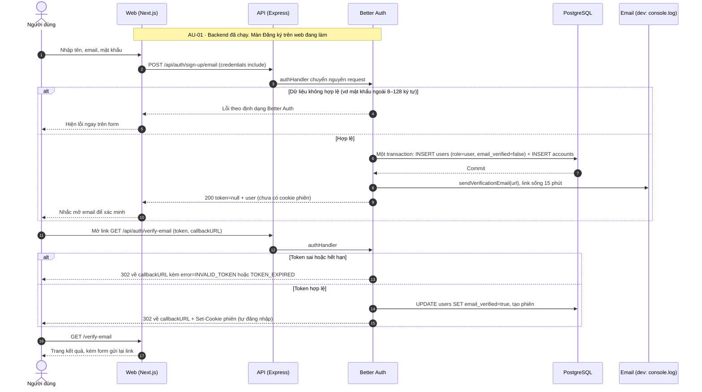

### AU-02 — Đăng nhập

Nguồn: `apps/api/src/auth/config.ts` (`sendOnSignIn`), `apps/api/AUTH.md`, `apps/web/features/auth/safe-callback-url.ts`.

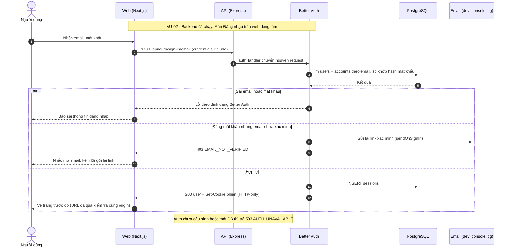

### AU-03 — Đăng xuất

Nguồn: `apps/api/AUTH.md` (`POST /api/auth/sign-out`).

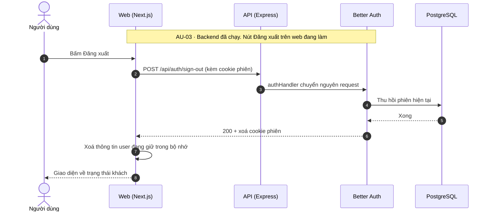

### AU-04 — Xem tài khoản

Nguồn: `apps/api/AUTH.md` (`get-session`, `update-user`), hook `before` trong `apps/api/src/auth/config.ts`.

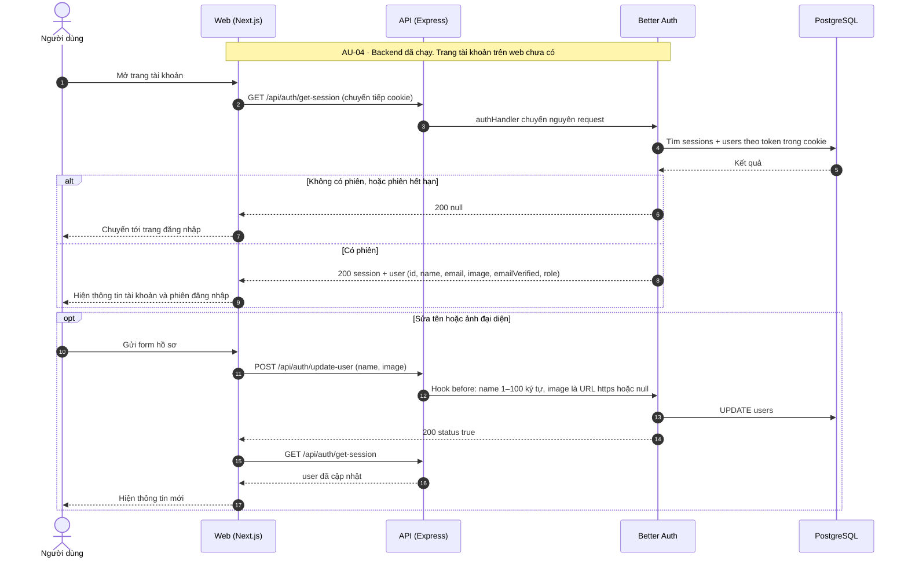

### AU-05 — Quên / đặt lại mật khẩu

Nguồn: `apps/web/features/auth/auth-source.ts`, `apps/web/components/auth/{forgot-password-form,reset-password-form}.tsx`, `apps/api/src/auth/config.ts` (`resetPasswordTokenExpiresIn`, `revokeSessionsOnPasswordReset`).

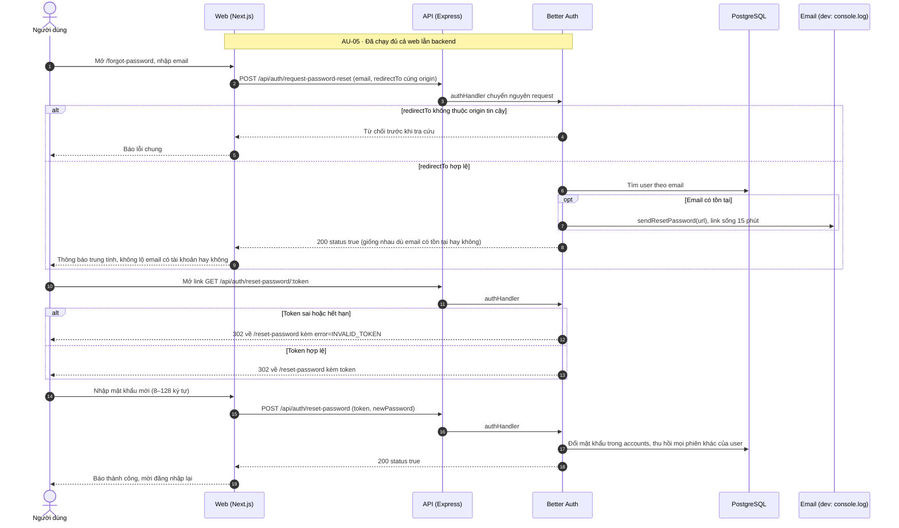

## Nhóm: Catalog (đã có code)

### CT-07 — Xem chi tiết component

Nguồn: `apps/web/app/components/[slug]/page.tsx`, `apps/web/features/catalog/catalog-source.ts`, route `GET /components/:slug` trong `apps/api/src/index.ts`, `apps/api/src/catalog/{queries,mapper}.ts`.

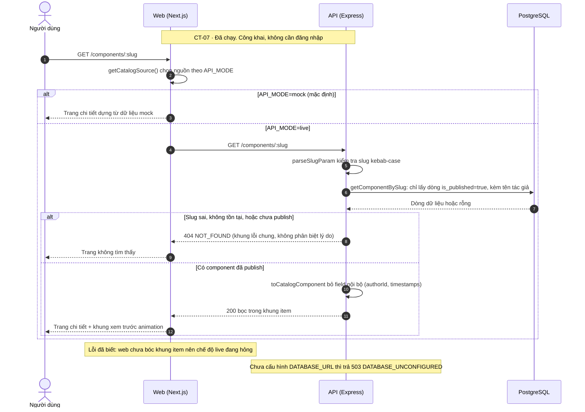

### SE-01 — Tạo listing (bản nháp)

Nguồn: route `POST /admin/components` + `adminGuard` trong `apps/api/src/index.ts`, `apps/api/src/auth/guards.ts` (`requireAuth`, `requireRole`), `apps/api/src/catalog/admin-queries.ts` (`insertComponent`, `findUniqueSlug`). Sơ đồ này cũng là sơ đồ **phân quyền** của hệ thống: mọi route admin đi qua đúng hai lớp guard này.

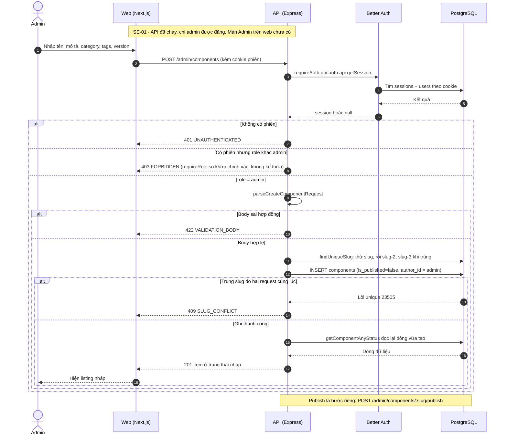

## Nhóm: Membership (dự kiến)

Ba sơ đồ dưới thay cho CM-01→03 kiểu "mua từng component". Chúng mô tả đề xuất trong RFC-02 (`docs/rfcs/membership.md`, PR #132) — **chưa có bảng, contract hay route nào**; tên endpoint và mã lỗi có thể đổi khi RFC được duyệt.

### CM-01 — Đăng ký gói Pro

Nguồn: RFC-02 mục 6 (API đề xuất) và mục 8 (provider `mock` cho giai đoạn đồ án).

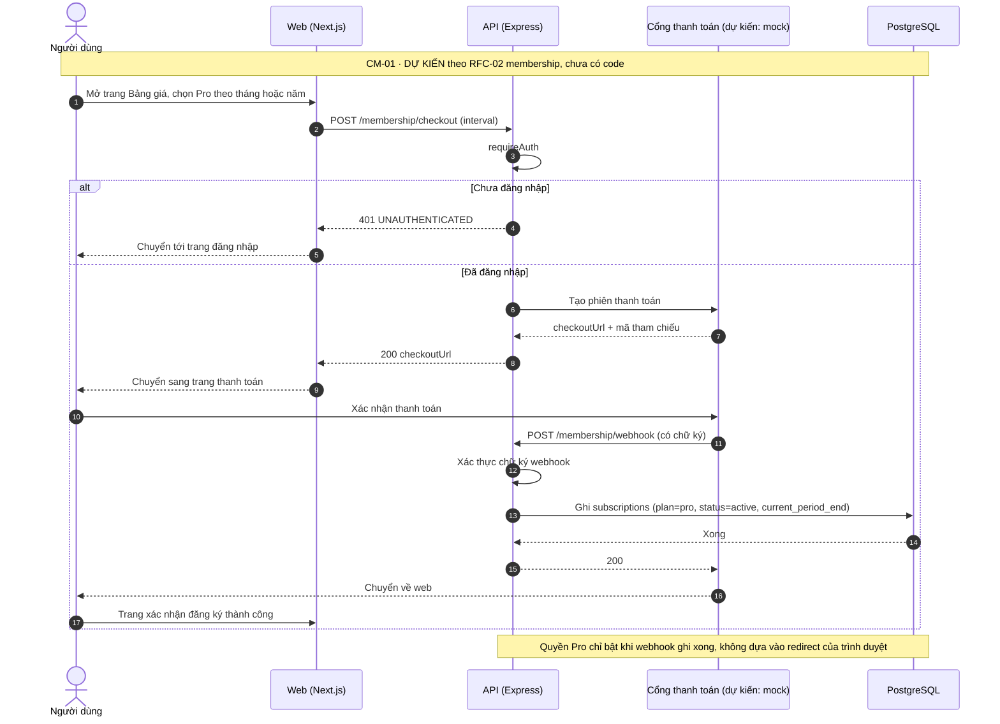

### CM-02 — Xem trạng thái gói

Nguồn: RFC-02 mục 3.2 (quy tắc "còn hiệu lực") và mục 6.

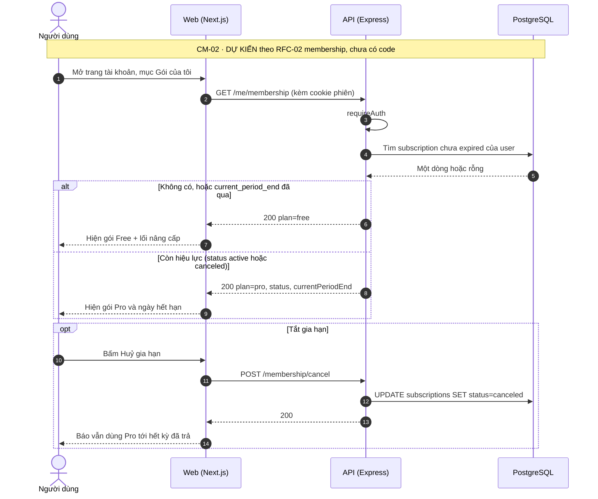

### CM-03 — Cài component Pro

Nguồn: RFC-02 mục 3.2–3.3 và mục 8 (cách CLI chứng minh quyền còn mở).

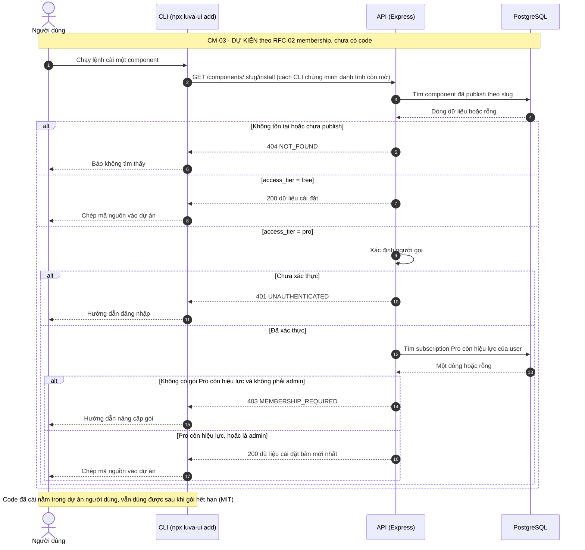

## Nhóm: Cộng đồng và Chat (dự kiến)

Năm sơ đồ dưới bám theo `docs/COMMUNITY_ARCHITECTURE.md` (§6.3, §7, §8.2) và RFC-01 (`docs/rfcs/community-chat-shared-contracts.md`). RFC-01 còn **PENDING REVIEW** (issue #68) và chưa có dòng code nào cho forum/chat.

### FR-06 — Xem thread + trả lời

Nguồn: `COMMUNITY_ARCHITECTURE.md` §7.1, RFC-01 (giới hạn 50 reply ở trang đầu).

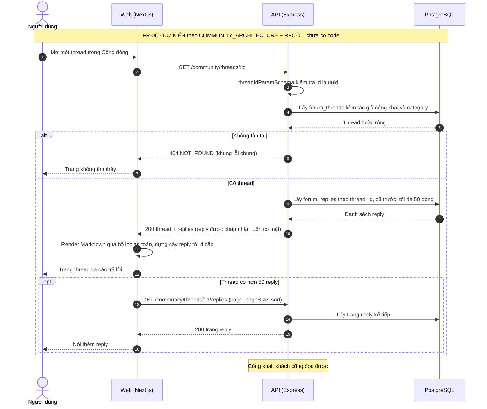

### FR-07 — Tạo thread

Nguồn: `COMMUNITY_ARCHITECTURE.md` §7.1 + §8.2 (rate limit, anti-spam), RFC-01 (`createThreadSchema`, bảng khớp threadType ↔ category).

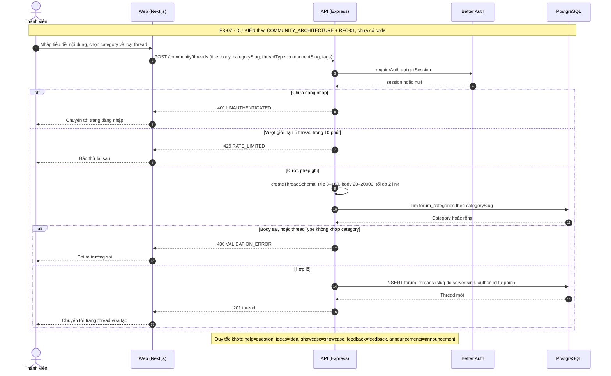

### FR-09 — Trả lời lồng nhau (tối đa 4 cấp)

Nguồn: `COMMUNITY_ARCHITECTURE.md` §6.3 (reply + counter trong một transaction), RFC-01 (`createReplySchema`, depth 0..4).

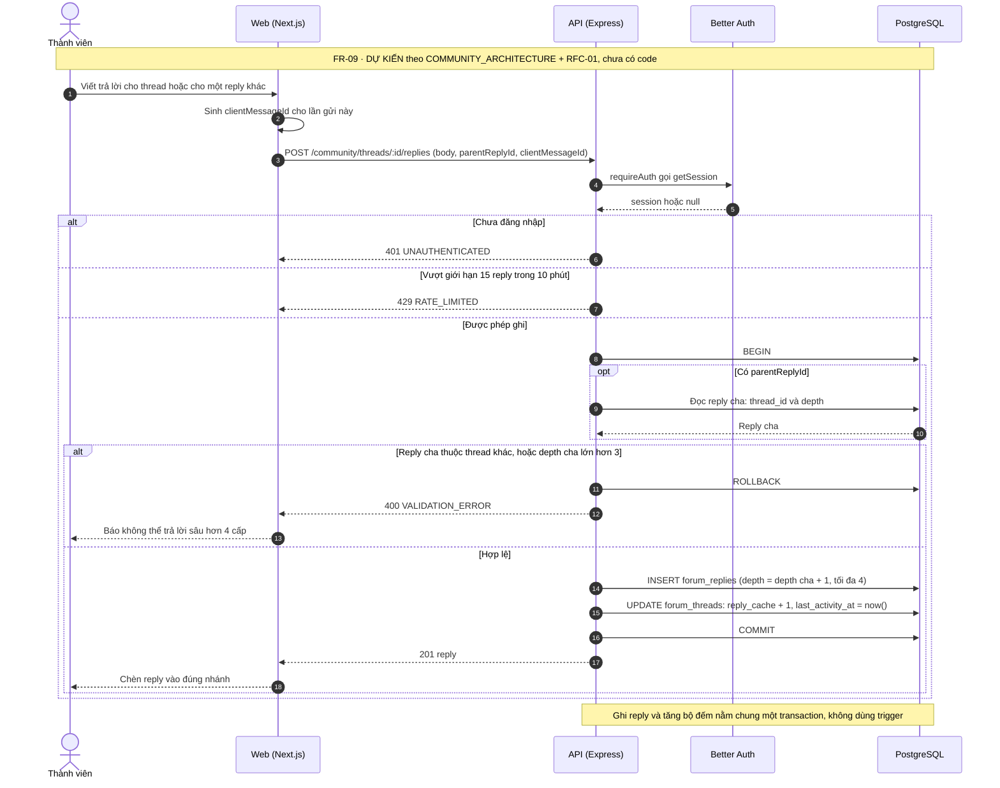

### CH-03 — Gửi / nhận tin nhắn realtime

Nguồn: `COMMUNITY_ARCHITECTURE.md` §6.3 (idempotency theo `clientMessageId`), §7.3–7.4 (event `ack`, `message.created`, WebSocket `/ws/chat`), §8.2 (rate limit).

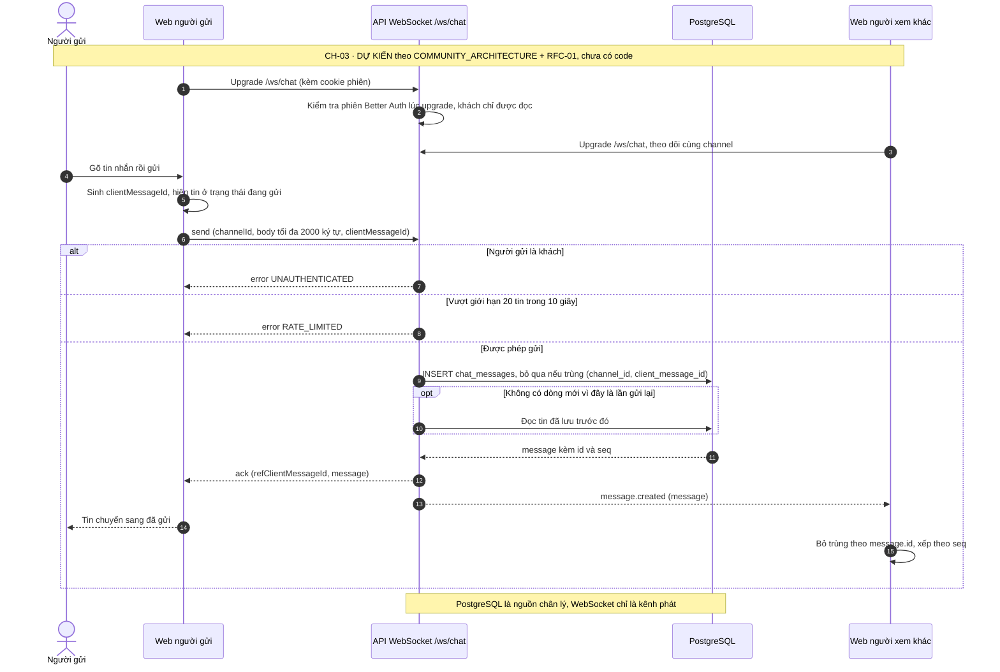

### CH-05 — Kết nối lại và tiếp tục

Nguồn: `COMMUNITY_ARCHITECTURE.md` §6.3 (`seq` là con trỏ tuyệt đối), §7.3 (heartbeat 30s, backoff, `resume.afterSeq`), §7.4.

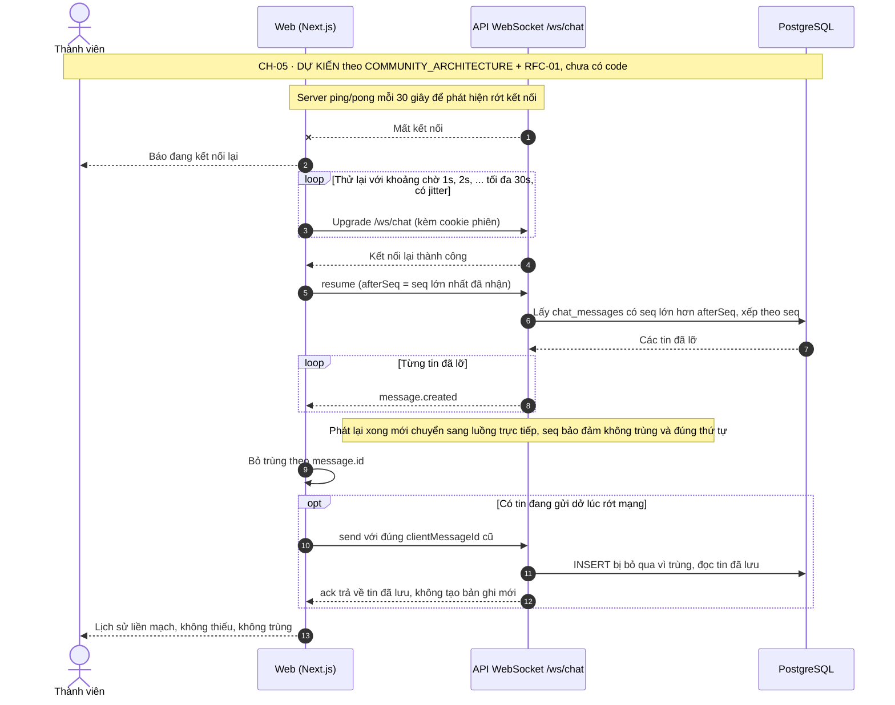

## Điểm lệch giữa bảng functions và hệ thống

Phát hiện khi đối chiếu để vẽ — cần cập nhật trong Google Sheet "Danh sách
functions":

| Dòng trong bảng | Bảng đang ghi | Hệ thống thực tế / quyết định hiện hành | Đề xuất sửa |
|---|---|---|---|
| SE-00, SE-01, SE-02 | Entity = **Member** tự tạo và sửa listing | Chỉ **admin** đăng (`docs/PRODUCT.md` mục 1; `POST /admin/components` sau `requireRole('admin')`) | Đổi Entity thành Admin, hoặc gộp vào AD-03 |
| CM-01 | Checkout & Purchase — mua 1 component | Chuyển sang membership (`docs/PRODUCT.md` mục 2, RFC-02) | Đổi thành "Subscribe to Pro (Đăng ký gói Pro)" |
| CM-02 | Confirm Purchase/License | Không còn đơn mua theo component | Đổi thành "View Membership Status (Xem trạng thái gói)" |
| CM-03 | Access/Download After Purchase | Quyền cài dựa trên gói Pro còn hiệu lực | Đổi thành "Install Pro Component (Cài component Pro)" |
| AU-01 | "Hệ thống tạo tài khoản" | Còn bước **xác minh email bắt buộc** trước khi đăng nhập được | Thêm bước 3: xác minh email qua link |
| CT-05 | Chưa có tuỳ chọn sort | Contract đã có `sort` = `newest` \| `name` (`listRequestSchema`) | Ghi rõ đã có ở contract, còn thiếu ở UI |

## Lỗi và khoảng trống ghi nhận khi vẽ

- **CT-07**: `apps/web/features/catalog/catalog-source.ts` coi cả response của
  `GET /components/:slug` là component, trong khi API trả `{ item }` — chế độ
  `API_MODE=live` sẽ hỏng trang chi tiết. Sửa trong phần việc Catalog của web.
- **AU-01 / AU-05**: email xác minh và đặt lại mật khẩu mới chỉ `console.log`;
  chưa có nhà cung cấp email (ghi trong `apps/api/AUTH.md`, việc của backend).
- **Các route admin `PATCH`**: CORS preflight của API hiện chỉ cho
  `GET, POST, OPTIONS`, nên `PATCH /admin/components/:slug` gọi khác origin ở
  môi trường dev sẽ bị chặn — cần backend xử lý trước khi dựng màn Admin.
