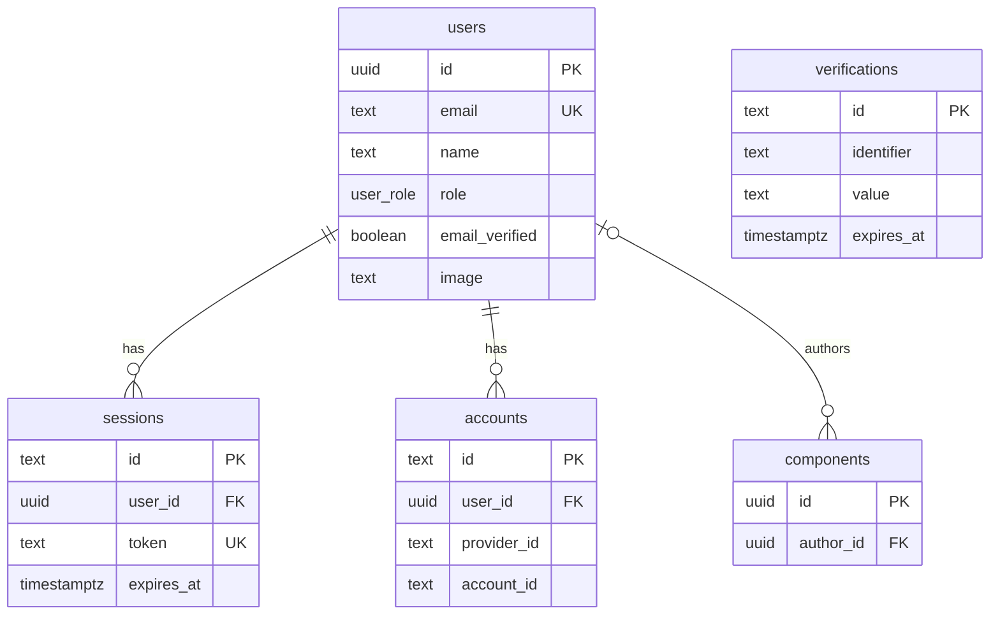

# Phân tích database tài khoản user

Issue: #90; đóng góp cho phân tích database tổng thể #84. Kết quả kiểm chứng của #94 đã được bổ sung; tài liệu chờ Long và Văn review. Mốc nguồn: `main` commit `9a5d196` (2026-11-05). Đây là kiểm kê repo và thử nghiệm trên PostgreSQL tạm, **không phải xác nhận database production**. Schema, migration đã áp dụng, dữ liệu, cấu hình triển khai và backup/restore ở môi trường thật: **UNVERIFIED**.

## Phạm vi và nguồn

Đối chiếu `packages/db/src/schema.ts`, `packages/db/drizzle/0000_fine_the_watchers.sql`, `0001_deep_leech.sql`, `0002_next_tenebrous.sql`, `meta/_journal.json`, `apps/api/src/auth/config.ts`, `guards.ts`, `apps/api/AUTH.md` và `docs/PRODUCT.md`. Journal ghi ba migration; đây không phải bằng chứng chúng đã chạy trên mọi môi trường. Issue #92 theo dõi xác minh email và reset password, không coi hai luồng đó đã triển khai.

## Quan hệ hiện tại

`verifications` không có FK đến `users`. Không suy ra quan hệ bằng identifier khi chưa đối chiếu hành vi Better Auth. Sơ đồ chỉ hiển thị các trường chính; bảng dưới liệt kê đầy đủ trường auth.

## Data dictionary

`NN` = NOT NULL; `?` = nullable; `now()` là database default, không chứng minh timestamp tự thay đổi khi UPDATE. Tất cả timestamp bên dưới có timezone.

| Bảng | Cột | Kiểu và ràng buộc | Mục đích / lưu ý |
| --- | --- | --- | --- |
| users | id | UUID, PK, default random UUID | Định danh ổn định |
| users | email | text, NN, unique index | Định danh đăng nhập, dữ liệu cá nhân |
| users | name | text, NN | Tên user |
| users | email_verified | boolean, NN, default false | Trạng thái xác minh email |
| users | image | text, ? | Tham chiếu ảnh |
| users | role | enum `user`, `seller`, `admin`, NN, default `user` | Server quản lý; một role mỗi user |
| users | created_at, updated_at | timestamptz, NN, default now() | Thời điểm tạo/cập nhật |
| sessions | id | text, PK | ID phiên |
| sessions | user_id | UUID, NN, FK, index | Xóa user cascade |
| sessions | token | text, NN, unique index | Bí mật phiên; không đưa vào log |
| sessions | expires_at | timestamptz, NN | Thời hạn phiên |
| sessions | ip_address, user_agent | text, ? | Metadata nhạy cảm; cần policy lưu giữ |
| sessions | created_at, updated_at | timestamptz, NN, default now() | Thời gian phiên |
| accounts | id | text, PK | ID account |
| accounts | user_id | UUID, NN, FK, index | Xóa user cascade |
| accounts | account_id, provider_id | text, NN | Định danh account/provider |
| accounts | password | text, ? | Credential dạng hash do Better Auth quản lý; không trả ra client |
| accounts | access_token, refresh_token, id_token | text, ? | Dữ liệu nhạy cảm của provider, không suy ra đã bật OAuth |
| accounts | access_token_expires_at, refresh_token_expires_at | timestamptz, ? | Thời hạn token provider |
| accounts | scope | text, ? | Phạm vi provider |
| accounts | created_at, updated_at | timestamptz, NN, default now() | Thời gian account |
| verifications | id | text, PK | ID dữ liệu xác minh |
| verifications | identifier, value | text, NN; index trên identifier | Dữ liệu nhạy cảm, cách sử dụng tùy Better Auth |
| verifications | expires_at | timestamptz, NN | Thời hạn |
| verifications | created_at, updated_at | timestamptz, NN, default now() | Thời gian |

`components.author_id` là UUID nullable, FK đến `users.id`, `ON DELETE SET NULL`. `accounts` và `sessions` dùng `ON DELETE CASCADE`; các FK trong migration dùng `ON UPDATE NO ACTION`. Không thấy unique index cho cặp `(provider_id, account_id)` trong schema/migration hiện tại. Better Auth truy vấn theo cặp này và báo lỗi nếu có nhiều dòng khớp, nên DB nên bảo vệ tính duy nhất đó. Cần kiểm tra collision chỉ đọc trước khi đề xuất migration; chưa có bằng chứng production có dữ liệu trùng.

Migration `0000` tạo users, enum và FK tác giả; `0001` thêm email_verified, image; `0002` tạo ba bảng Better Auth và index/FK. Các cột trong bảng trên được đối chiếu từ schema và SQL, chưa đối chiếu database đã deploy.

## Ranh giới dữ liệu

- Better Auth quản lý credential, verification và session; ứng dụng quản lý policy role và quyền nghiệp vụ. Không xây user/session thứ hai.
- User object của auth contract cho phép client dùng `id`, `name`, `email`, `image`, `emailVerified`, `role`; không chứa password hash. Signup/signin có thể trả session token ở ngoài object user, theo contract Better Auth. Không coi toàn bộ response là không có token.
- `sessions.token`, `accounts.password`, provider token và `verifications.value` là dữ liệu nhạy cảm; không log hoặc trả trong DTO profile. IP/user-agent và email cũng cần hạn chế truy cập.
- Chưa có public profile DTO được chốt. API công khai tương lai chỉ trả trường được phép, không trả nguyên database row.

## Luồng và quyết định cần chốt

| Luồng | Actor và dữ liệu | Hiện trạng / ngoại lệ cần xử lý |
| --- | --- | --- |
| Đăng ký | Guest; users + account + session | Có auto sign-in; role user. Cần kiểm tra chuẩn hóa email, trùng đồng thời; #92 cân nhắc xác minh trước đăng nhập |
| Xác minh email | Chủ email; users.email_verified và dữ liệu Better Auth | Chưa có delivery; link hết hạn/dùng lại, gửi lại và user cũ chưa xác minh thuộc #92 |
| Đăng nhập/đăng xuất | User; account + session | Có backend; xác minh cookie, role và trạng thái phiên theo cấu hình thực tế |
| Sửa profile | Chủ tài khoản; name/image | PR #91 còn draft tại thời điểm phân tích; không coi là đã merge |
| Đổi email/mật khẩu, reset | Chủ tài khoản; account và dữ liệu xác minh | Reset delivery thuộc #92; đổi email và policy xác thực lại chưa chốt. Xác minh hành vi version đã pin trước khi chọn schema |
| Quản lý session | Chủ tài khoản; sessions | Có sign-out; UI xem/thu hồi từng thiết bị và thời hạn chưa được chốt |
| Khóa/mở khóa | Admin được cấp quyền; user + session | Chưa có policy/schema được duyệt; cột trạng thái đơn lẻ không tự thu hồi session hoặc chặn request |
| Xóa/ẩn danh | Chủ tài khoản hoặc admin theo policy | Cần chốt xác thực lại, lưu giữ, đăng ký lại email, component đã publish và backup |
| Cấp/thu hồi role | Admin được phép | Role input bị chặn khi signup; quy trình bootstrap, audit và hiệu lực lên session cần chốt |

## Đề xuất MVP

Giữ `users` hiện tại cùng ba bảng Better Auth. Tên và ảnh dùng `users`; chưa tạo profile riêng, bảng permission hay bảng token mới. `seller` tồn tại trong enum nhưng seller onboarding nằm ngoài MVP; admin không mặc định có quyền seller. Sơ đồ đề xuất ở giai đoạn này **giống sơ đồ hiện tại**: chưa đề xuất bảng/cột bổ sung; thay đổi sau phụ thuộc quyết định khóa/xóa, profile và kết quả kiểm chứng Better Auth.

## Kiểm tra mã Better Auth 1.7.14 đang cài

Đọc source package trong worktree của PR #91, đối chiếu phiên bản `1.7.14` được pin trong `apps/api/package.json`; đây là phân tích mã, chưa chạy thử với Postgres hoặc môi trường deploy.

- `dist/api/routes/sign-up.mjs` chuyển email thành chữ thường bằng `toLowerCase()` trước khi tra cứu/tạo user. `sign-in.mjs` tra cứu email sau `toLowerCase()`; `dist/db/internal-adapter.mjs` cũng chuyển chữ thường trong `findUserByEmail` và các đường tạo/cập nhật user đã đọc. Chưa kết luận tất cả luồng hoặc dữ liệu được ghi ngoài Better Auth tuân thủ cùng quy tắc. Unique index `users_email_unique` không tự chuyển dữ liệu thành chữ thường; dữ liệu import/ghi trực tiếp cần được kiểm kê trước khi chọn constraint mới.
- **Đường ghi trong repo:** `rg` trên `apps/api/src` và `packages` tìm thấy các API production chỉ truy vấn `users.name` cho catalog; thao tác `insert/update/delete` trực tiếp vào `users` nằm trong fixture integration test. Không có đường ghi `accounts` trực tiếp ngoài Better Auth trong phần code đã rà. Việc này giới hạn rủi ro ở app hiện tại, nhưng không chứng minh không có script vận hành hoặc writer ngoài repo.
- `internal-adapter.mjs` tìm account theo `(providerId, accountId)` trong `findAccountOwnerByKey` và `findAccountByKey`; nếu tìm thấy nhiều hơn một dòng, thư viện ném lỗi. Schema hiện không có unique index tương ứng. Thử trên PostgreSQL tạm xác nhận DB cho phép chèn cặp trùng, nhưng không chứng minh luồng Better Auth hiện tại tạo ra dữ liệu đó. Khuyến nghị một unique constraint/index trên cặp này để bảo vệ khóa account mà Better Auth đang dùng; trước khi làm migration, cần chạy truy vấn chỉ đọc đếm collision theo cặp. Nếu có collision, phải xác minh chủ sở hữu và xử lý từng trường hợp; không tự xóa hoặc gộp credential. Chưa bật OAuth và không lấy OAuth làm giả định.
- `dist/context/create-context.mjs` mặc định `expiresIn=604800`, `updateAge=86400`, `freshAge=86400` giây khi không cấu hình tương ứng. Auth config hiện không override các giá trị này. Đây là default trong source package, không thay thế kiểm chứng runtime, chính sách phiên hoặc tác động của `rememberMe`.
- **Signup không nguyên tử (#94), đã tái hiện và có thay đổi trong nhánh fix riêng:** `dist/api/routes/sign-up.mjs` bọc signup bằng `runWithTransaction`, sau đó tạo user rồi link credential account. `@better-auth/drizzle-adapter` 1.7.14 mặc định `transaction: false`; config trước thay đổi không đặt tùy chọn này. Trên PostgreSQL 17 tạm, áp ba migration rồi giả lập lỗi INSERT account bằng trigger: API trả 500 nhưng còn 1 user, 0 account. Với Better Auth bật `transaction: true`, cùng lỗi trả 500 và còn 0 user, 0 account. Nhánh fix hiện bật `transaction: true` và ghi contract trong `apps/api/AUTH.md`; thay đổi chưa được merge. Kết quả chỉ xác nhận hành vi trên môi trường thử, không chứng minh production bị ảnh hưởng.
- **Thử #94 trên PostgreSQL tạm:** hai signup đồng thời với email chỉ khác hoa/thường trả 200 và 422, tạo 1 user và 1 account; đăng nhập bằng email viết hoa trả 200. Điều này kiểm chứng các đường Better Auth đã thử, không áp dụng cho ghi trực tiếp hoặc mọi luồng tương lai. Thử INSERT trực tiếp hai account cùng `(provider_id, account_id)` với fixture tạo được 2 dòng, xác nhận DB chưa chặn cặp trùng; không chứng minh luồng ứng dụng hiện tạo trùng. Không in email thật, token hay hash.
- Cùng file mặc định bật rate limit khi thư viện nhận diện môi trường production; cấu hình mặc định chung là 100 request/10 giây và storage `memory` nếu không có secondary storage. Thư viện có thể áp dụng rule riêng theo route; không dùng con số chung để suy ra mọi endpoint. Memory không chia sẻ counter giữa các instance; production cần xác minh số instance, IP qua proxy, rule theo endpoint và lớp bảo vệ hạ tầng trước khi chọn giải pháp.
- Với `autoSignIn=true` và `requireEmailVerification=false` hiện tại, source signup ném lỗi email đã tồn tại thay vì generic response; integration test hiện có kỳ vọng `422`. Source cũng gọi logger ở mức info với email trong tình huống signup trùng. Khả năng log thực tế phụ thuộc cấu hình logger/môi trường; cần xác minh và che dữ liệu cá nhân phù hợp. Chính sách response và thay đổi cấu hình signup được phối hợp tại #92, không sửa trong phân tích DB này.

Các kết luận trên có thể thay đổi khi nâng Better Auth; cần kiểm tra lại version, config và test trước khi triển khai. Session cache, hành vi thu hồi, giới hạn theo route và ghi log thực tế vẫn **UNVERIFIED**.

## Rủi ro và kiểm chứng

| Ưu tiên | Điều kiện / ảnh hưởng | Bằng chứng và bước tiếp theo |
| --- | --- | --- |
| Cao | Bật bắt buộc xác minh có thể chặn user cũ chưa xác minh | Config hiện `requireEmailVerification: false`; #92 chốt rollout và gửi lại. Số user bị ảnh hưởng **UNVERIFIED** |
| Cao | Thiếu policy reset và delivery khiến user không tự khôi phục được | `AUTH.md` đặt email delivery ngoài scope; #92 triển khai và kiểm chứng |
| Cao | Xóa user xóa session/account và để tác giả component null | FK trong 0000/0002; chốt policy trước khi bật xóa, không khẳng định có mất dữ liệu production |
| Cao | Session còn hiệu lực sau thay đổi quyền/trạng thái có thể tạo quyền cũ nếu kiểm tra/caching sai | `requireAuth` lấy session và `requireRole` đọc role; xác minh vòng đời/cache trong version pin và test thu hồi; chưa xác nhận lỗ hổng |
| Trung bình | Email viết hoa/thường hoặc đồng thời tạo có thể gây xung đột nếu policy và unique không thống nhất | Unique trên text email; kiểm tra chuẩn hóa Better Auth và DB, kiểm kê collision an toàn trước khi siết constraint |
| Trung bình | Timestamps `updated_at` có thể không phản ánh mọi đường ghi | Schema chỉ có default; xác minh từng đường update, chưa khẳng định sai dữ liệu |
| Trung bình | Dò email, spam email hoặc thử password hàng loạt nếu kiểm soát không đủ | Source 1.7.14 có rate limit mặc định trong production, lưu memory; rule theo route và hiệu quả thực tế qua proxy/nhiều instance **UNVERIFIED** |
| Trung bình | Backup không thể khôi phục hoặc chứa PII quá lâu | Production **UNVERIFIED**; xác minh quyền, retention và diễn tập restore |

## Migration và kiểm thử đề xuất

Không thay đổi schema hoặc migration trong #94. Trước khi thêm unique index `(provider_id, account_id)`, chạy truy vấn chỉ đọc trả về số collision; nếu có collision, review từng trường hợp và chuẩn bị backup/restore trước khi làm sạch. Sau khi không còn collision, thêm index trong migration mới, kiểm tra index và đường Better Auth trên DB mới lẫn DB có dữ liệu đại diện; rollback ứng dụng không cần xóa dữ liệu, còn rollback index chỉ thực hiện nếu đã đánh giá lại nguy cơ tái tạo collision. Với email, giữ chuẩn hóa chữ thường trong Better Auth; chỉ cân nhắc unique index trên `lower(email)` nếu xuất hiện một đường ghi không tuân thủ chuẩn hóa, sau khi đếm collision không lộ giá trị. Không backfill hoặc ghi production trong issue này. Migration đã áp dụng là bất biến.

Kế hoạch kiểm thử: DB mới và DB có dữ liệu đại diện; unique/FK và concurrent signup; email canonicalization; session hết hạn/thu hồi; role và thay đổi quyền; xác minh/reset (#92); xóa user và component; kiểm tra response/log không lộ bí mật; email service lỗi; backup/restore. Đây là kế hoạch, **không phải kết quả test**.

## Câu hỏi cần Long và Văn thống nhất

1. Xác minh trước đăng nhập hay giới hạn chức năng? Rollout cho user cũ như thế nào? (#92)
2. MVP chỉ name/image hay có profile công khai? (#91 là PR draft.)
3. Có đổi email, khóa/mở khóa, tự xóa user trong MVP không? Quy trình và dữ liệu giữ lại?
4. Thời hạn session, thu hồi sau reset/khóa/đổi role, và quản lý thiết bị?
5. Bootstrap admin, MFA, recovery, audit và lưu giữ log thực hiện ở mức nào trước public?

Long review database/API; Văn review ảnh hưởng frontend/contract. Chưa ghi nhận kết quả review; issue #90 và #84 vẫn mở.
